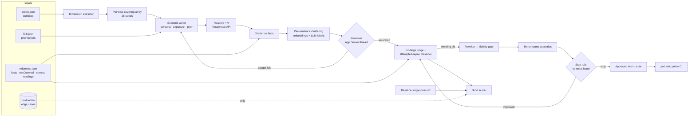

# Architecture

Every box appends events to `runs/<runId>/events.jsonl` (`src/shared/events.ts`). The server tails that log over SSE. The UI is a pure fold of it (`foldRun` / `applyEvent` in `web/src/model.ts`), so a replay and a live run render through the same code.

## Runtime layers

| Layer | Module | Notes |
|---|---|---|
| Contracts | `src/shared/` | zod schemas double as LLM structured-output schemas |
| Model access | `src/core/llm/gateway.ts` | Bulk generation goes to the Responses API (`LLM_BULK_BACKEND`). Agent threads go to Codex App Server (`LLM_AGENT_BACKEND`). Embeddings use the Responses API. Classification goes to the Decisions API (`gateway.decide`, `gpt-6-luna`, ≤ 400 questions per request). Content-addressed cache in `cache/` |
| App Server client | `src/core/llm/appserver.ts` | One `codex app-server` process; ephemeral threads + `outputSchema` for structured calls; `dynamicTools` for agents |
| Responses client | `src/core/llm/responses.ts` | Structured Outputs, embeddings, and a function-calling loop (agent fallback) |
| Decisions client | `src/core/llm/decisions.ts` | Predicate / choice / score answers with probabilities. Chunks at 400 questions, keeps answers in question order, and sends the same shared evidence first in every chunk so the prompt-cache prefix is reused |
| Run log | `src/core/store.ts` | `RunWriter` (validated, contiguous `seq`), `readEvents`, `tailEvents` |
| Policies | `src/core/policy.ts` | `policy.json`, `reference.json`, `folk.json`; version 0 = published text |
| API | `src/core/server.ts` | `/api/runs`, `/api/runs/:id/events`, `/api/runs/:id/stream`, `/api/policies[/:id]` |
| Pipeline | `src/sampler/`, `src/reviewer/`, `src/eval/`, `src/sandbox/` | owned per AGENTS.md |

## Stages

### 1. Dimensions and seed grid
The LLM extracts 5–7 dimensions from the policy text: properties that change how a person reads the rule or how it affects them. Each dimension has 2–4 levels and a rationale. A human can edit them.

A greedy pairwise covering array (seeded) then picks 16 seed rows covering every level pair at least once.

COD dimensions we expect:
- payment instruments
- account sharing
- failure history (own fault vs courier-marked)
- prior belief (folk version)
- region
- exposure channel
- digital literacy

### 2. Scenario writer
Each grid row becomes a `Scenario`:
- a persona card
- an `Exposure`:
  - `surfaceIds`: what they actually see (checkout line, full article, nothing)
  - `folkVersionId`: a friend's version / prior belief
  - `attention`: `skim` = 20 seconds on a phone; `careful`
- a concrete trigger situation in Vietnamese

Exposure is what makes readers realistic. In this morning's spike, readers given the whole text and no context read like analysts and converged on the same reading.

### 3. Reader
Readers are `gpt-6.1-sol` at low effort and see only the exposure. Output follows the `Reading` schema:
- paraphrase
- quote-anchored interpretations, each with a Vietnamese meaning and an English gloss
- open questions
- intended actions (`ActionEnum`)
- feeling

`anchor` maps each quote to a sentence id using NFC-normalised character-trigram Jaccard ≥ 0.5. Below that, one Decisions `choice` over the sentence ids plus `none` resolves it. `none` gives `sentenceId = null`: the reader is reasoning about a rule the text doesn't state.

**Homogeneity gate:** if the mean pairwise similarity of seed paraphrases is high, strengthen exposure and priors before going further.

### 4. Grader (Decisions API)
Grading is classification, so it runs on the Decisions API, not generation.
- **Shared evidence:** the policy text plus `reference.facts` and `notCovered`. It is identical across requests, so it forms the cached prefix.
- **Per reading:** the reading goes in as `input_json`.
- **Per interpretation:** one `choice` question (`consistent | conflicts | outside | unclear`), plus a `choice` over fact ids for the conflicting ones.

`Grade.confidence` is the probability of the chosen label. Decision thresholds are calibrated against about 20 interpretations hand-labelled by P4 at G1, and agreement with those labels is reported (see evaluation.md).

### 5. Clustering
Per sentence:
- embed `glossEn`
- average-linkage agglomerative clustering at cosine distance ~0.25, tuned on the seeds
- one LLM pass labels the clusters (VN/EN) and merges near-duplicates

Fallback when embeddings fail: one LLM grouping call per sentence. Interpretations with `sentenceId = null` form "rule not in text" clusters.

### 5b. Codebook coding: the measurement instrument (Decisions API)
Clustering is generative and unstable from run to run, so we don't compare clusters across runs. Instead, each cluster label becomes a belief statement in a **codebook**, for example "Người đọc tin rằng đơn bị shipper ghi 'khách không nhận' sẽ bị tính là lỗi của họ".

Every reading of every policy version is coded against the same codebook with Decisions `predicate` questions: P(reading holds belief k). Fifty readings × 15 beliefs is 750 questions, which is two requests.

The resulting reading × belief probability matrix (`codings.added` events) is the single instrument behind:
- split scores, as soft NMI between a dimension's levels and the belief probabilities
- finding reproduction after a rewrite
- the noise band, from coding the same scenarios twice
- human-check mapping, where human answers are coded against the same beliefs

Because the instrument is held fixed, before/after numbers compare like with like.

### 6. Adaptive allocation
After each batch, for each dimension *d*:
- normalised mutual information between *d*'s levels and the codebook probabilities (soft membership), weighted by each belief's entropy, plus the same for intended actions
- a permutation null (200 shuffles), giving a z-score

The reviewer is a persistent App Server thread with tools to inspect the split table, clusters and readings. It returns an `AllocationDecision`: next batch size, focus dimensions, optionally new levels, and a rationale.

Code enforces the guardrails:
- budget 50; `n` is clamped to the remaining budget
- `ceil(0.2·n)` fully random rows per batch
- schema validation
- new levels only on policy-specific dimensions (never on the built-in exposure dimensions)

If the reviewer's output is unusable, code falls back to focusing the top two dimensions with z > 1 (otherwise the top one).

Exploration stops when the budget is spent, or after two consecutive batches in which no cluster reaches ≥ 2 distinct readers for the first time (the discovery curve). Cluster identity across re-clustering is matched by member overlap within the same sentence.

### 7. Findings and attempted-repair classification
The judge turns clusters into at most 10 `Finding`s. For each finding:
1. The rewriter proposes a minimal edit.
2. A fresh, blind fidelity checker returns a `FidelityResult` against `reference.facts`.
3. The finding is classified from that result:

| Repair outcome | Class |
|---|---|
| Passes, no new commitments | `wording_fix` |
| Any resolving fix must change a stated fact (`requiresNewFact.kind = changes_rule`) | `design_gap` |
| Any resolving fix needs a fact the reference lacks (`missing_info`) | `unresolvable` |

The failed repair is kept as evidence.

### 8. Rewrite loop
1. Merge all wording fixes into version *v+1*.
   - Change budget: ≤ 40% of sentences.
   - The whole text must pass the fidelity gate. On failure, retry once with the violations, then drop the offending edit.
2. Rerun the same scenarios. Only the policy text changes.
3. Grade the new readings (Decisions) and code them against the **v0 codebook** (Decisions). New clusters among the rerun readings are reported separately as "new misreadings introduced by the rewrite".
4. Emit an `Iteration`:

| Field | Meaning |
|---|---|
| `conflictRate` | Share of readings with ≥ 1 conflicting interpretation, with a bootstrap 95% CI |
| `findingReproduction` | Per finding: mean codebook probability of its beliefs over its original scenarios, before vs after |
| `openQuestionRate` | — |
| `noiseBand` | \|Δ conflict rate\| between two fresh runs of v0 |

**Stop** when any of these holds:
- no open wording findings remain
- Δ conflict rate ≤ noise band
- 3 iterations reached
- the fidelity gate fails twice

The reason is logged in `stop.decided`. A human approves the final text (`rewrite.approved`).

### 9. Policy CI
`pwt test <policy-file> --suite <runId>` reruns the frozen scenarios against an edited text and compares the result with the run's last iteration. It exits non-zero if the conflict rate rises beyond the noise band or a resolved finding reappears. The UI's "Re-test edit" runs the 10-scenario smoke suite (~40 s).

### 10. Incentive probe (cut first if time is short)
A deterministic rule sandbox with explicit assumption parameters: threshold, window, which courier statuses count, recovery rule, lock scope.

fast-check invariants:
- locked ⇔ the countable failures in the trailing window ≥ threshold
- prepaid orders never increment the count
- time is monotonic

One strategic persona is seeded from observed intentions and plays 180 days through dynamic tools. It is presented as "what the wording rewards under assumptions A1–A4", never as a platform vulnerability.
